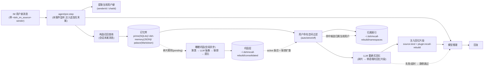
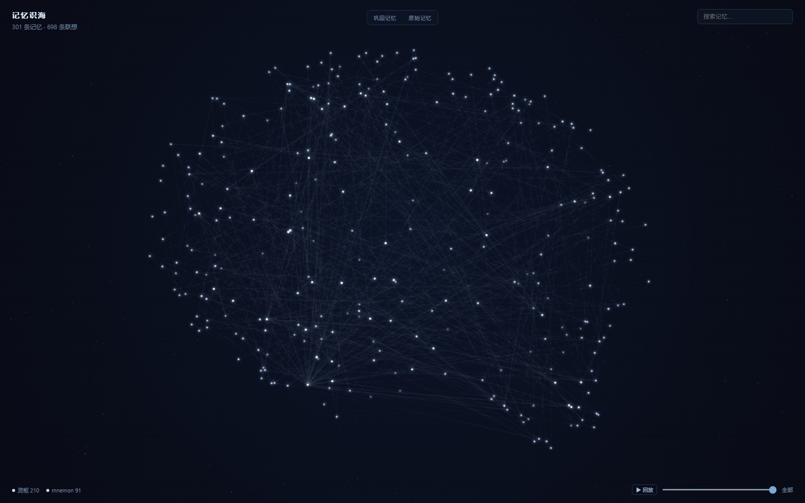
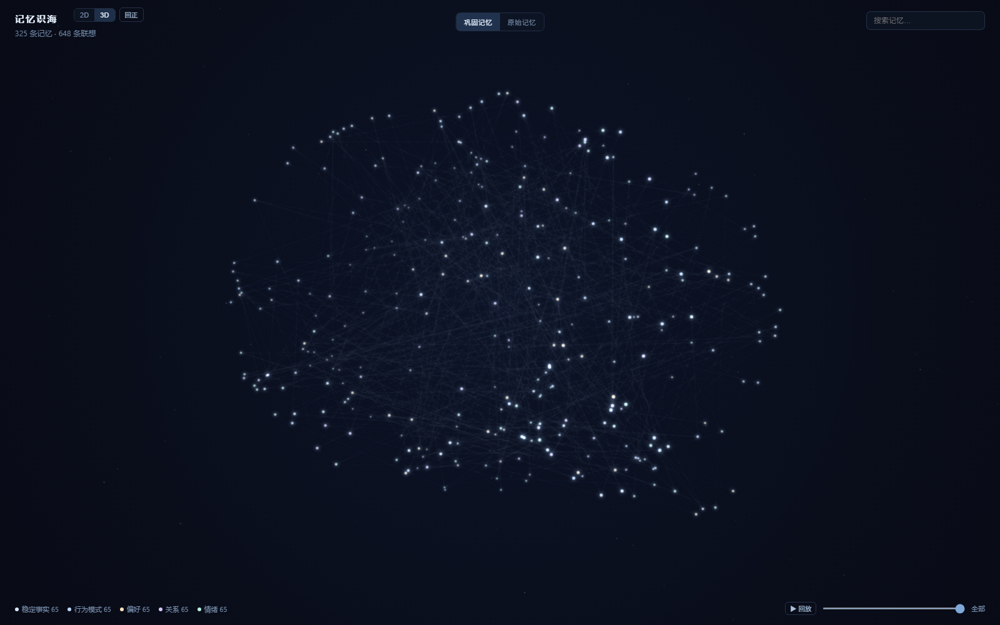

# dsh-recall-rebuild

[](https://www.npmjs.com/package/dsh-recall-rebuild)
[](https://github.com/linkpain/dsh-recall-rebuild/blob/main/LICENSE)
[](https://github.com/linkpain/dsh-recall-rebuild/stargazers)
[](https://github.com/deepseek-ai/DeepSeek-Harness)
[](https://nodejs.org)

> **重建式回忆增强插件(DeepSeek Harness)**:不抢存储,只改「回忆的呈现方式」——让助手"想起来了",而不是"念档案"。
> **Enhancer for DSH memory plugins**: recall that feels like *remembering*, not *quoting a file*.

现有 DSH 记忆插件(`dsh-prime-memory`、`dsh-mnemon`、灵枢等)已经把**存储层**做得很扎实:跨会话捕获、蒸馏、持久化都成熟,值得先装。本插件**不重复造存储**,只在三件事上做增强:

1. **回忆的重建**:检索到的碎片交给 LLM,按当前对话现场重建成带语境与情绪的回忆片段再注入;
2. **记忆的沉淀**:空闲时把碎片聚类、抽象成稳定记忆,连成联想图,低频的降权而不是删除(睡眠巩固);
3. **记忆的可见**:侧边栏「记忆识海」把长期记忆画成一颗会随数据长大的大脑,2D / 3D 双视角。

---

## 目录

- [痛点:回忆不应该是"念档案"](#痛点回忆不应该是念档案)
- [特性](#特性)
- [安装](#安装)
- [工作原理](#工作原理)
- [配置项](#配置项)
- [支持的记忆源](#支持的记忆源)
- [长期记忆子系统:睡眠巩固与联想扩散](#长期记忆子系统睡眠巩固与联想扩散)
- [管理长期记忆(命令)](#管理长期记忆命令)
- [记忆识海:把长期记忆画成一颗正在长成的大脑](#记忆识海把长期记忆画成一颗正在长成的大脑)
- [观测:怎么判断重建是否真的更好](#观测怎么判断重建是否真的更好)
- [检索质量:中文为什么召不回来](#检索质量中文为什么召不回来)
- [Roadmap](#roadmap)
- [局限(如实声明)](#局限如实声明)
- [开发与验证](#开发与验证)
- [License](#license)
- [English Overview](#english-overview)

## 痛点:回忆不应该是"念档案"

**传统记忆插件(录音式)**:检索 → 把原文/摘要塞进上下文。

> 用户:我今天心情不太好。
> 助手(传统):根据我的记录,你喜欢喝冰美式咖啡、养了一只叫煤球的猫、上周去过成都出差。你怎么了?

**本插件(重建式回忆)**:检索 → LLM 按当前对话现场重建 → 注入一段"回忆"。

> 用户:我今天心情不太好。
> 助手(本插件):记得你养了只叫煤球的黑猫,平时它一蹭你你就笑;上周你还说靠冰美式续命。今天是不顺心了吗?

同一份记忆,前者是"读档案",后者是"想起来了"。**对桌宠、虚拟角色、陪伴型助手来说,这决定了它像机器还是像活人。**

## 特性

**回忆**

- **生成式重建**:`agent/pre-step` 用会话末尾消息召回碎片,LLM 重建为带语境/情绪/时间感的回忆片段,替代生硬原文注入;
- **永不阻塞对话**:无记忆库 / 无模型路由 / 超时 / 重建失败,一律静默跳过本轮;
- **提示词缓存友好**:注入只**追加在消息批次末尾**,不插头部、不改写历史中部——相邻 step 的请求前缀逐字节相同,历史缓存不会被每轮的注入打断;
- **跨轮不重复念叨**:同一 agent 在 30 分钟内注入过的记忆降到候选末尾(不删除,本轮只有它时仍会注入);
- **时效衰减**:分数按 `priority × max(0.5, 0.5^(天数/30))` 衰减,半衰期 30 天、下限 0.5——刚说的事优先,旧账不会被彻底压死。

**存储(只读)**

- **只读增强,零污染**:以 `readOnly` 打开现有记忆库,不重写捕获管线、不写任何数据,装/卸都不影响原插件;
- **17 种记忆源可插拔**:`auto` 同时打开所有探测到的库并做 **RRF 融合**,装几个就融几个,不再「赢者通吃」;
- **IM 用户级命名空间隔离**:QQ/微信 多人共用角色时,解析桥接插件注入的 `<dsh_im_source>` sender 信息,把记忆按用户隔离——A 的记忆不会注入给 B;同一人跨会话共享。归属索引写在插件自己的目录,仍不碰底层库;
- **与生态共存不错位**:注入消息 `source.kind='plugin:recall-rebuild'`,不会被 prime-memory 当作新用户消息再次捕获/蒸馏;
- **零额外运行时依赖**:Node 22+ 内置 `node:sqlite` 读库,安装即用。

**沉淀(长期记忆)**

- **睡眠巩固 + 联想扩散**:空闲时「聚类 → LLM 抽象 → 联想 → 遗忘」,巩固层条目召回时优先注入、命中越用越稳、强关联主题顺带想起;
- **遗忘可逆**:低置信 + 30 天未命中进 `dormant`(降权不删),被重新提起/命中/edit 就回到 `active`;
- **改口覆盖**:「我住在杭州」→「我住在成都」时旧条目标记 `superseded`,永不注入,但 `edit` 仍可翻案;
- **重复观察强化**:几乎一字不差地又说一遍,不新建条目,而是把已有条目的置信度 +0.1。

**可见**

- **记忆识海可视化**:侧边栏面板把记忆画成深空点云——点是记忆、线是联想;节点越多边缘越密,几百条之后自己长成一颗大脑。**2D / 3D 双视角**、**原始 / 巩固双数据源**、时间轴回放、搜索高亮、悬停卡片;
- **重建质量可观测**:每轮写一条 JSONL 审计日志,「原始检索碎片 ↔ 重建后片段」同屏对比 + 注入方式/耗时/跳过原因,零额外注入、零 token 成本。

**检索**

- **中文召回不再"整句一个词元"**:内置分词切成「拉丁词 ∪ 中文二元组」,FTS5 严格 AND 之外补四条召回通道(宽松 OR、LIKE 覆盖度、单字覆盖、字符 n-gram 语义),RRF 融合后再语义精排——中文 recall@5 从 **0%** 提到 **70.0%**(附可复跑评测脚本)。

## 适合谁

- DSH **桌宠 / 虚拟角色 / 陪伴型 AI** 玩家——想要"像人一样记着你",而不是"查到你的档案";
- 已把角色接入 **QQ / 微信** 等 IM 的 DSH 用户——角色同时服务多个人的私聊/群聊时,希望**每个用户的记忆互不串味**,同一人跨会话记忆共享;
- 觉得现有记忆插件"注入的原文太生硬、像在念记录"的开发者与用户。

## 安装

前置:

- DeepSeek Harness `>=0.1.0-rc.2 <0.3.0-0`(0.1.x / 0.2.x 全系列,含 rc / alpha);
- Node ≥ 22.5(需要内置 `node:sqlite`);
- 已安装并运行过任一受支持的记忆插件(见[支持的记忆源](#支持的记忆源),共 17 种),且已有记忆数据;装了多个也没关系,`auto` 会把它们融合起来读。

```bash
dsh plugin --profile <你的配置文件名> add dsh-recall-rebuild
```

安装后无需手动改 profile 的 `cordis.patch.yml`(包内组合层自动插入插件行)。如需覆盖配置,在 profile 的 `cordis.patch.yml` 写**顶层裸 patch**(同 id 再 insert 会报 duplicate loader entry,按行整体替换、不深合并):

```yaml
- id: recall-rebuild
  name: dsh-recall-rebuild
  config:
    enabled: true
    rebuild:
      maxResults: 5
      maxOutputChars: 600
      timeoutMs: 8000
    inject:
      strategy: replace   # replace = 批次内已有本插件注入时原位替换; append = 一律追加(两者都只动末尾)
    sea:
      view: 3d            # 记忆识海默认用 3D 视角打开
      depth: 0.6
```

> 装插件后需要**完全退出并重开 DSH 桌面端**,侧边栏面板才会出现(客户端 bundle 在启动时装配)。

## 工作原理



一句话:**提取用户 → 检索 → 用户隔离过滤 → 合并巩固层 → 重建 → 注入**,而不是**检索 → 注入**;碎片在空闲时「睡眠巩固」沉淀为稳定记忆,下次召回优先想起。

**与现有插件怎么错开**:

- 注入消息 `source.kind` 用 v4 语义 `plugin:recall-rebuild`,与 prime-memory 的 `plugin:memory` 互不干扰;capture 侧只收 `source.kind==='user'`,天然不被二次捕获;
- 召回查询只取「人说的话」:构建查询前先剔除本插件的注入与其它插件的原文召回,再取末尾窗口。否则上一轮召回的内容会变成下一轮的检索词,越滚越偏(自我强化回路),且注入会把真正的用户原话挤出窗口;
- 注入位置:一律**追加在消息批次末尾**(提示词缓存按逐字节前缀命中,插头部或改写历史中部都会在注入点切断前缀,让整段历史缓存每轮全废);`strategy=replace` 只在「本 step 批次里已有本插件自己的注入」时原位替换(同 step 重试场景),其它插件的原文召回**原地不动**。

## 配置项

### 主体

| 键 | 默认 | 说明 |
| --- | --- | --- |
| `enabled` | `true` | 总开关 |
| `dataDir` | `''` | 记忆库目录;空 = `$DSH_HOME/memory` |
| `source` | `auto` | 记忆来源。`auto` = 探测到几个就融合几个(多库 RRF 融合 + 正文去重);也可显式指定下面任一 id:见[支持的记忆源](#支持的记忆源) |
| `sourceRefreshMs` | `60000` | 通用记忆源的重读间隔(ms)。prime 每次实时查库;其余 16 个源把条目读进内存换检索速度,靠这个间隔按需重读。`0` = 打开时读一次就定住 |

### 重建 `rebuild.`

| 键 | 默认 | 说明 |
| --- | --- | --- |
| `enabled` | `true` | 重建式回忆开关;`false` 退化为原文检索注入 |
| `maxResults` | `5` | 每轮检索条数 |
| `maxMemoryChars` | `400` | 单条记忆进重建 prompt 的字符上限 |
| `maxTotalChars` | `2000` | 重建 prompt 记忆总量上限 |
| `maxOutputChars` | `600` | 重建片段输出上限 |
| `temperature` | `0.7` | 重建调用温度 |
| `maxTokens` | `1024` | 重建调用输出 token 上限 |
| `timeoutMs` | `8000` | 重建总超时;超时跳过本轮 |

### 注入 `inject.` / 查询 `query.`

| 键 | 默认 | 说明 |
| --- | --- | --- |
| `inject.strategy` | `replace` | `replace` = 批次内已有本插件注入时原位替换(同 step 重试);`append` = 一律追加。两者都只动批次末尾 |
| `inject.maxChars` | `1200` | 注入正文单条上限 |
| `inject.includeSources` | `true` | 注入时附记忆来源 id 标注 |
| `query.tailMessages` | `8` | 召回查询取会话末尾消息条数 |
| `query.maxChars` | `1200` | 召回查询字符上限 |

### 用户隔离 `user.`

| 键 | 默认 | 说明 |
| --- | --- | --- |
| `isolation` | `auto` | `auto` 剔除「明确属于其他用户」的记忆(无主记忆默认可见,命中后归位);`strict` 只注入已归属当前用户的记忆(新用户零记忆起步);`off` 不过滤。桌面直接对话自动不隔离 |
| `isolationDir` | `''` | 归属索引目录;空 = `<DSH_HOME>/recall-rebuild/namespaces` |
| `sourceTagPattern` | `''` | 覆盖内置 `<dsh_im_source>` 解析正则;不同桥接插件字段不同时自定义(需含一个捕获组取用户 id) |

### 观测 `observability.`

| 键 | 默认 | 说明 |
| --- | --- | --- |
| `logEnabled` | `true` | 每轮重建审计日志开关(JSON Lines,按天滚动) |
| `logDir` | `''` | 日志目录;空 = `<DSH_HOME>/recall-rebuild/logs` |
| `includeFragments` | `true` | 日志是否记录原始检索碎片(与重建片段同屏对比);`false` 只记重建结果 |
| `statsEnabled` | `true` | 是否写统计文件 `stats.json`(30s 节流) |
| `retainDays` | `30` | 按天日志保留天数;只删自己命名的 `recall-YYYY-MM-DD.log`。`0` = 永不删除 |

### 睡眠巩固 `consolidate.`

| 键 | 默认 | 说明 |
| --- | --- | --- |
| `enabled` | `true` | 睡眠巩固总开关 |
| `dir` | `''` | 巩固层目录;空 = `<DSH_HOME>/recall-rebuild/consolidated` |
| `minFragments` | `20` | 待巩固碎片累积多少条触发一次 |
| `minIntervalMs` | `21600000` | 距上次巩固最短间隔(6h) |
| `checkIntervalMs` | `3600000` | 定时检查间隔(1h) |
| `maxFragmentsPerRun` | `50` | 单次巩固最多处理碎片数 |
| `clusterThreshold` | `0.25` | 聚类相似度阈值(同主题碎片 ≥ 阈值归为一簇) |
| `maxCluster` | `8` | 单簇最多碎片数 |
| `maxOutputChars` | `400` | 单条巩固输出字符上限 |
| `temperature` | `0.4` | 巩固调用温度(低于重建,求稳) |
| `maxTokens` | `1024` | 巩固调用输出 token 上限 |
| `timeoutMs` | `20000` | 单簇巩固超时(离线任务可放宽) |
| `confidenceThreshold` | `0.4` | 遗忘阈值:置信度低于它且长期未命中 → dormant |
| `dormantDays` | `30` | 多少天未命中(且低置信)进入 dormant |
| `reviveSimilarity` | `0.15` | 休眠条目被本轮碎片「重新提起」的相似度门槛 |
| `supersedeThreshold` | `0.6` | 改口覆盖阈值(字符子序列比例) |
| `reinforceThreshold` | `0.85` | 重复观察强化阈值(几乎一字不差则上调置信度) |

### 命令 `commands.`

| 键 | 默认 | 说明 |
| --- | --- | --- |
| `enabled` | `true` | 巩固层交互命令总开关 |
| `name` | `recall-rebuild` | 注册的命令名(不含前导 `/`);与其它插件冲突时改名 |

### 记忆识海 `sea.`

| 键 | 默认 | 说明 |
| --- | --- | --- |
| `enabled` | `true` | 面板总开关;`false` = 不挂载 `/recall-rebuild/sea/` 路由 |
| `maxNodes` | `1200` | 最多渲染多少个节点(超出时**丢最老的**);900 以内稳定 60fps |
| `source` | `raw` | 默认数据源:`raw` = 底层记忆库(开箱即见),`consolidated` = 巩固后的稳定条目 |
| `rawLinkThreshold` | `0.12` | 原始层连边阈值:两条记忆的字符 n-gram 余弦超过它才连线(越低线越密) |
| `view` | `2d` | 默认视角:`2d` = 正面脑图,`3d` = 可 360° 拖动的立体点云。**面板里切过之后以本地记忆为准** |
| `depth` | `0.6` | 3D 脑「厚度」(厚/宽比,0.3–0.9):0.42 扁平、0.60 接近真实比例、0.85 偏厚 |
| `perspective` | `soft` | 3D 透视强度:`soft` = 温和(近似正交,形状稳),`strong` = 强烈(近大远小明显) |
| `fissure` | `true` | 3D 是否留**纵向裂**(左右半球之间的缝);`false` 时点会连成实心椭球 |
| `autoRotate` | `false` | 3D 闲置时是否缓慢自转(≈6°/s);默认静置,拖过才动 |

> `sea.*` 只是**首次打开时的默认值**。用户在面板里动过(切模式、改厚度、转相机)之后,以浏览器 localStorage 为准,不再被配置覆盖——配置是"出厂设置",不是"强制设置"。

## 支持的记忆源

`source: auto` 会探测下表的全部 17 个源,命中几个就打开几个并做 **RRF 融合**(每路取 `max(limit*3, 12)` 条参与融合),再按正文前 120 字归一化去重——同时装两三个记忆插件也不会互相遮蔽。也可以用 `source: <id>` 只读其中一个。

| id | 对应插件 | 存储形态 | 探测路径 |
| --- | --- | --- | --- |
| `prime` | dsh-prime-memory | SQLite FTS5 | `$dataDir` / `$DSH_HOME/memory` 下的 `memory.db`、`prime.db` |
| `loci` | dsh-loci | SQLite | `$DSH_HOME/memory/loci/memory.db` |
| `living` | dsh-living-memory | SQLite | `$MEMORY_DB_PATH` 或 `$DSH_HOME/dsh-living-memory/memory.sqlite3` |
| `ltm` | @tr1v3r/dsh-ltm | SQLite | `<cwd>/memory/ltm.db`、`$DSH_HOME/memory/ltm.db`、`$DSH_HOME/storages/ltm.db` |
| `nebula` | dsh-memory-nebula | SQLite | `<cwd>/.dsh-meow/memory.db`、`$DSH_HOME/.dsh-meow/memory.db` |
| `dsh-memory-sqlite` | dsh-memory / 同类 SQLite 变体 | SQLite | `<cwd>/memory/memory.db`、`$DSH_HOME/memory/memory.db` |
| `lingshu` | @furongjun1999/dsh-memory(灵枢) | Markdown 节点 | `$MDCG_DATA_ROOT` 或 `$DSH_HOME/.dsh-memory/data/mdcg` |
| `mnemon` | dsh-mnemon | Markdown | `~/.mnemon/runtime`(`MEMORY.md`/`USER.md`)与 `~/.mnemon/documents` |
| `palace` | dsh-memory-palace | Markdown | `~/.deepseek-harness/MEMORY.md`、`<cwd>/.deepseek-harness/MEMORY.md` |
| `jipika` | @jipika/dsh-memory | Markdown 分片 | `$DSH_HOME/memory/topics/*.md` |
| `hub` | dsh-memory-hub | Markdown | `$DSH_HOME/memory-hub/{knowledge,records}` |
| `longterm` | dsh-longterm-memory | Markdown vault | `$DSH_LONGTERM_VAULT`、`$DSH_HOME/longterm-memory`、`<cwd>/.dsh-longterm-memory` |
| `dsh-memory` | @max-null/dsh-memory | JSON | `$DSH_HOME/storages/memory.json`、`<cwd>/.dsh/storages/memory.json` |
| `memory-engine` | dsh-memory-engine / @wilshi/dsh-memory-engine | JSON | `$DSH_HOME/memory-engine/memories.json` |
| `tiers` | dsh-memory-tiers | JSON 分层 | `$DSH_HOME/storages/memory/`(`L1/L2/L3/DL1/DL2/DL3.json`) |
| `memory-vector` | @restregular/dsh-memory | JSONL | `$DSH_HOME/memory-vector/*.jsonl`(排除 `approvals.jsonl`);同名 `.vec` 边车里的稠密向量一并读取 |
| `auto-memory` | dsh-auto-memory | Markdown 单文件 | `$DSH_HOME/memory/_user/`、`$DSH_HOME/memory/--<slug>--/` 下的 `*.md` |

> `$DSH_HOME` 默认 `~/.dsh`。**读取**分两类:14 个源共用通用读取原语(`sqlite` / `markdown` / `json` / `jsonl`)并直接交给 `makeTextStore`;`prime`、`palace`、`dsh-memory` 各有专用解析(prime 读 `l1_records` + FTS5,palace 按 `##` 章节切分,dsh-memory 按 `unit.tables.blocks` 并过滤未审核/隔离条目)。**检索**只有两个出口:prime 走自己的 FTS5 + LIKE + 字符 n-gram 五路融合,其余 16 个源(含 palace 与 dsh-memory)全部落到 `rankDocHits` 这同一个打分函数。

> 新增一个源只需在 `src/sources/registry.ts` 里加一条 `SourceSpec`,不必改配置面。用 `/recall-rebuild sources` 可以查看本机探测结果。

## 长期记忆子系统:睡眠巩固与联想扩散

类比人脑:**底层记忆插件 = 海马体**(即时捕获碎片),**本插件的巩固层 = 新皮层**(把碎片沉淀为稳定记忆)。这层只存在本插件自己的目录(`~/.dsh/recall-rebuild/consolidated/`),底层记忆库始终保持只读。

**一次巩固(空闲异步,不阻塞对话)做什么**:

1. **累积**:每轮检索命中的碎片进入 `pending.json`(去重、限量);
2. **聚类**:纯本地按 2-gram 相似度把同主题碎片分簇(无需 LLM、零成本);
3. **LLM 抽象**:每簇提炼为 1-3 条稳定长期记忆(`stable-fact / pattern / preference / relationship / mood`),忽略一次性噪音;
4. **联想扩散**:同簇条目两两建边(`links.json`,端点含本轮被强化的旧条目)。扩散走两跳:一跳带出同簇条目,二跳再带出它连着的那一层(分数更低)。边权按 30 天半衰期衰减,门槛 `DIFFUSE_OPTS.hop1Min/hop2Min = 0.5`(`src/recall.ts`)。反复提起时边权累加、`at` 前移,衰减被抵消——**用得越多的联想越牢**;跨簇不连边(无关话题只是碰巧同一轮被巩固,连上就是噪音);
5. **遗忘与唤醒(双向)**:低置信 + 30 天未命中 → `dormant`(召回降权,不删除、不写底层库);休眠条目被重新提起(`reviveSimilarity`)、被命中、被 `edit` 修正,就回到 `active`。遗忘可逆——「一时想不起来」不等于「永久失忆」;
6. **越用越稳**:每次命中 `touchCount+1` 且置信度小幅上调(封顶 0.95),高置信条目优先注入;
7. **改口覆盖**:「我住在杭州」→「我住在成都」,新记忆不会和旧记忆并存打对台——字符子序列分足够高且只差一个值时,旧条目标记 `superseded` 并指向新条目:永不注入、永不被命中唤醒,但 `edit` 仍可翻案。判断用字符 LCS 而非 Jaccard,因为改口的差异只占一个槽位,词袋相似度会被稀释到 0.25 而漏判;
8. **重复观察强化**:同一件事又被观察到(几乎一字不差,阈值 `reinforceThreshold` 高于改口的 `supersedeThreshold`)时,不新建条目,而是把已有记忆的置信度上调 0.1——比召回命中的 0.05 更强,因为「用户又亲口说了一遍」是比「检索又匹配到」更硬的证据。

触发:启动后空闲 10s 查一次,之后每 `checkIntervalMs` 查一次;pending 达标且距上次巩固超 `minIntervalMs` 才真正执行;失败保留 pending 下次再试。

**定位**:它不替代底层记忆插件,也不重复存储——底层负责「记住」,巩固层负责「把记住的东西变成稳定的自己」。

## 管理长期记忆(命令)

在支持 `/` 命令的 DSH 界面输入(宿主没有命令服务时自动跳过,不影响插件主体):

| 命令 | 作用 |
| --- | --- |
| `/recall-rebuild list [--all]` | 查看长期记忆:类型 / 置信度 / 命中次数 / 更新时间;dormant 单独标出。默认只显示当前用户的记忆 + 共享记忆,`--all` 查看全部 |
| `/recall-rebuild now` | 立即触发一次睡眠巩固(绕过最短间隔;pending 为空时提示) |
| `/recall-rebuild edit <id> <新内容>` | 修正一条记忆的内容;改完即抬置信度并回到 `active`,改口能真的救回一条将遗忘的记忆 |
| `/recall-rebuild forget <id>` | 主动删除一条记忆及其联想边(显式操作,不写底层库) |
| `/recall-rebuild sources` | 列出 17 种记忆源在本机的探测结果(✓ 已找到 / · 未找到),并显示当前生效的 `source`——排查「为什么没召回」先看这里 |
| `/recall-rebuild help` | 显示用法 |

命令的可见范围与召回隔离是同一套规则:能识别 IM 用户时只能查看/修改「该用户 + 无主共享」的记忆;桌面会话或 `--all` 时不受限。命令名冲突时用 `commands.name` 改名。

## 记忆识海:把长期记忆画成一颗正在长成的大脑

记忆不只是数据,它也可以**被看见**。装好后侧边栏会多一个「记忆识海」面板,把记忆投影成一片深空里的点云。



> 真机截图(2D):301 条记忆、698 条联想,左下角是各记忆源的条数分布,顶部中间可切「巩固记忆 / 原始记忆」,底部时间轴能回放这颗大脑是怎么长出来的。



> 同一份数据的 3D 模式:点是记忆、线是联想,按深度做亮度与尺寸衰减,所以近处的点亮、远处的点淡,转动时能看出体积。

### 两个数据源,顶部一键切

- **原始记忆**(默认):直接读底层记忆库(灵枢 / mnemon / prime / palace / dsh-memory 都支持),库里有什么就画什么——**装完打开就有东西看**,不需要先跑一轮巩固。原始层没有现成的边,连线按两条记忆的字符 n-gram 余弦相似度现算(每点只留最强的 3 条,阈值 `sea.rawLinkThreshold`);
- **巩固记忆**:画 `memories.json` 与 `links.json`,也就是「睡眠巩固」把碎片聚类重写之后的稳定条目——五类配色、边是真实的联想强度(带 30 天半衰期衰减)。新装时这里通常是空的,因为还没跑过巩固。

两层的差别正是巩固层存在的理由:**原始层密度高但语义重复**(同一件事说过五遍就是五个点),巩固层把重复的收敛成一条。先看原始层的「毛球」,再看巩固层的「骨架」,能直观看出蒸馏做了什么。

### 2D / 3D:两种看法,同一份数据

标题右侧是 `[2D | 3D | 回正]` 三个按钮,3D 模式下再多一个 `⚙`(参数)。

**2D** 是正面视角:一眼看清形状与分布,拖拽浮层、悬停卡片、搜索高亮、时间轴回放全都在这一层。**3D** 把同一批点沿纵深撑开成一颗真的球状点云:

| 操作 | 效果 |
| --- | --- |
| 按住拖动 | 360° 旋转(带惯性,松手继续滑一小段) |
| 滚轮 | 拉近 / 推远(视距 1.2–8.0) |
| 双击 / 点「回正」 | 回到默认视角(−27°, 12°) |
| `⚙` | 展开 3D 参数浮层 |

切换不是硬切:点会**平滑地飞进纵深**(500ms 缓动),3D 画布同时淡入;切回 2D 反向再来一遍。**上次用的模式与相机角度会记住**(localStorage 的 `sea.mode` / `sea.cam3d` / `sea.opts3d`),下次打开还是那个视角。

**关键约束:2D 一个像素都没改。** 3D 复用 2D 的同一套拒绝采样来决定 (u, v),只额外算一个 z,所以两种模式下每个点的平面位置**逐位相同**(verify 里 `uvMismatch 0` 守的就是这条)。`morph=0` 时 3D 渲染器画出来的就是 2D 那一帧。

### 3D 参数浮层(`⚙`)

| 参数 | 档位 | 说明 |
| --- | --- | --- |
| **大脑厚度** | 0.42 / **0.60** / 0.85 | 厚/宽比。0.42 扁平(像俯视图),0.60 接近真实比例,0.85 偏厚(像一颗饱满的球) |
| **闲置自转** | **关** / 开 | 开启后约 6°/s 缓慢自转;一旦手动拖动就自动关掉(否则会跟你抢方向) |
| **透视强度** | **温和** / 强烈 | 温和 = 视距 5.0,近似正交、形状稳;强烈 = 视距 1.8,近大远小明显 |

三项都即时生效并落盘。**配置里的 `sea.depth` / `sea.autoRotate` / `sea.perspective` 只是首次打开时的出厂值**——你在面板里动过之后以浏览器为准。

### 面板细节

- **点是记忆,线是联想**:五类记忆各有配色(稳定事实 / 行为模式 / 偏好 / 关系 / 情绪),线的亮暗就是联想强度;
- **越用越像大脑**:节点少时是零星星点,几百条之后边缘因为密度自然形成亮的皮层带、内部保持通透——形状是**点自己长出来的**,不画任何 3D 网格;
- **零记忆时留一个很淡的虚线框架**,像一张还没开始填的蓝图;到 140 条左右框架完全消失(3D 下框架还会随视角淡出,正面才看得见);
- **可以问它**:搜索框按内容过滤,悬停看记忆卡片,底部时间轴能回放「这颗大脑是怎么长出来的」。

技术上刻意做到**零依赖、零构建**:Canvas 2D + 四个 ES 模块(`sea-core.js` 几何、`sea-view.js` 2D、`sea-view3d.js` 3D、`sea-app.js` 接线),900 条以内稳定 60fps;3D 模式下按帧耗时自动降级(连续 12 帧均值超 22ms 就先减边到最强 600 条、再只画点)。面板是一个同源 iframe,指向宿主注册的 `/recall-rebuild/sea/`;宿主侧只做静态文件与一个 JSON 数据端点,带完整的信任 fence(只认本机回环 / 部署声明的可信域,拒绝跨站),整层只读。

> 装插件后需要**完全退出并重开 DSH 桌面端**面板才会出现(客户端 bundle 在启动时装配)。设计取舍与实现细节见 [docs/memory-sea-brain.md](docs/memory-sea-brain.md)。

## 观测:怎么判断重建是否真的更好

每轮运行后,打开日志目录(`~/.dsh/recall-rebuild/logs/`):

- **`recall-YYYY-MM-DD.log`**:每轮一行 JSON,同一轮里 `fragments`(原始检索碎片)与 `rebuilt`(重建后片段)并排——直接对比同一份记忆的两种呈现,自己判断哪种更「像人」;
- **`stats.json`**:累计轮数 / 命中轮 / 重建成功 / 注入 / 替换数,看重建的覆盖面和替换率。

字段速览:`round` 轮次、`userKey` 当前 IM 用户、`hitCount` 命中数、`memoryIds` 依据记忆 id、`fragments` 原始碎片、`rebuilt` 重建片段、`injection` 注入方式(`replaced` 原位替换了本插件上一版注入 / `appended` 追加在末尾 / `none` 未注入)、`latencyMs` 耗时、`error` 跳过原因。

> 想运行时真·对比(同一轮同时看到原文召回与重建片段),把 `inject.strategy` 设为 `append`;想零成本对比,看日志即可。

## 检索质量:中文为什么召不回来

底层记忆库里中文占绝大多数,而 SQLite FTS5 的 `unicode61` 分词器**把一整句中文当成一个词元**。原来的查询构造直接用句子里切出的 token 拼 `AND`,于是「用户说他最近特别喜欢吃火锅」这条记忆,用「火锅」「吃火锅」「深夜」去查**全部 0 命中**——记忆存进去了,但永远召不回来。

修法不是换分词器(trigram 对 2 字词同样失效),而是**在应用层把查询切开**:

1. **分词**:拉丁词(过滤停用词)+ 中文二元组(过滤高频虚词二元组)取并集;
2. **五路召回**:① 严格 FTS(AND,精度最高,权重 1)② 宽松 FTS(OR,扩召回,0.8)③ LIKE 覆盖度打分(整词兜底,1)④ 单字覆盖(unicode61 下唯一能救换说法的通道,0.6)⑤ **字符 n-gram 语义余弦**(跨同义改写,0.7);
3. **RRF 融合**(Reciprocal Rank Fusion,`k=60`):按「各路名次」而不是「各路分数」合并——分数不可比,名次可比;
4. **语义精排**:对融合后的头部候选再算一次「RRF 名次分 + 0.8 × 余弦」。只加通道不加精排,语义通道捞回来的同义改写会被字面通道的顺序稀释掉(实测 65.0% → 精排后 70.0%)。

第 ⑤ 路值得单独解释:DSH 的 LLM 服务不提供 embedding 接口,引入本地嵌入模型又会破坏「零运行时依赖」这条铁律。折中方案是把**字符 n-gram 频次当向量维度**做余弦相似度(拉丁词权重 1、中文二元组 1、中文单字 0.4)——它不是语义模型,但足以把「女朋友 / 对象」「医生 / 值夜班」这类**同义改写**捞回来,零依赖、毫秒级、可离线复现。真正的语义模型仍要由上游插件提供 —— 但**上游已经算好的向量可以直接用**:`memory-vector`(`@restregular/dsh-memory`)会把 BGE-M3 向量落在同名 `.vec` 边车里(首行是模型与维度身份头),本插件读出后做余弦邻居扩展,依旧零依赖、零模型、不联网。身份头缺失或模型不一致时整份不采信 —— 拿两个模型的余弦比大小没有意义。

配套评测脚本 `scripts/eval-recall.mjs` 用 40 条中文记忆 + 换说法查询(不是原文子串)跑 before/after:

| 实现 | recall@5 | MRR@5 | 未命中 |
| --- | --- | --- | --- |
| 旧分词(整句一个词元) | 0.0% | 0.000 | 40/40 |
| 新分词(拉丁词 + 中文二元组) | 47.5% | 0.412 | 21/40 |
| + 宽松 OR 通道 | 47.5% | 0.412 | 21/40 |
| + 单字覆盖通道 | 62.5% | 0.533 | 15/40 |
| + 语义通道(不精排) | 65.0% | 0.596 | 14/40 |
| + 语义精排(当前) | **70.0%** | **0.615** | 12/40 |

剩下 12 条属**零字面重叠**(如「我这个配置跑得动 Docker 吗」对「MacBook Pro 14 寸 M2 Pro 芯片」)或需要真实语义理解(「我室友白天在家睡觉」对「夜班护士」)。字符 n-gram 已经是「自己算」的极限;再往上要么由上游插件把向量算好(见 ⑤ 的 `.vec` 边车通道),要么本插件引入嵌入模型——后者会破坏「零额外依赖」,不做。

**prime 之外的 16 个源共用同一个检索出口 `rankDocHits`**:词元覆盖 / 单字覆盖 / 字符 n-gram 余弦三路候选 → RRF 融合 → 语义精排 → 时效衰减,条目自带上游稠密向量时再补一路邻居扩展。其中 14 个源(`makeTextStore`)在 v0.1.15 补齐了这三路,`palace` 与 `dsh-memory` 当时漏在外面 —— 它们各抄了一份「命中词数 × 长度归一化」打分,v0.1.15 的提升一点没吃到,而评测也只覆盖 prime 与通用源,这条脱节没有任何数字看住。现在两者改走同一出口,同一批 40 条中文 fixture 上:

| 路径 | recall@5(旧打分) | recall@5(当前) | MRR@5(当前) |
| --- | --- | --- | --- |
| `makeTextStore`(14 个源) | 47.5% | **70.0%** | 0.625 |
| `palace`(Markdown) | 47.5% | **70.0%** | 0.594 |
| `dsh-memory`(JSON) | 47.5% | **70.0%** | 0.625 |

三路的未命中集合完全一致(`m06/m08/m10/m11/m16/m22/m24/m27`),都是零字面重叠。闸门 `npm run test:eval` 对四条路径分别卡 0.65,任何一侧退化都会被单独的数字看住。

## Roadmap

- [x] 主流记忆源 adapter(一次覆盖 17 个插件 + 多库融合)—— v0.1.13;
- [x] `dsh-auto-memory` adapter(纯 Markdown 单文件 + frontmatter,墓碑/禁用/过期过滤);
- [ ] 更小众的记忆源 adapter(`dsh-memory-vault`、`dsh-memory-gate`、`@openviking/dsh-memory-plugin` 等变体);
- [x] IM 用户级命名空间隔离(跨 QQ/微信的同一人记忆共享)—— v0.1.3;
- [x] 重建质量可观测(每轮 JSONL 日志 + stats)—— v0.1.4;
- [x] 睡眠巩固 / 联想扩散(聚类 → LLM 抽象 → 联想 → 遗忘)—— v0.1.5;
- [x] 巩固层交互命令(list / now / edit / forget)—— v0.1.6;
- [x] 中文检索修复(二元组分词 + 五路 RRF 融合,recall@5 0% → 70.0%)—— v0.1.7/v0.1.8;
- [x] 时效衰减(半衰期 30 天)+ 跨轮去重(30 分钟窗口)—— v0.1.7;
- [x] 遗忘真正生效 + 命中落盘批量化 —— v0.1.7;
- [x] CI(typecheck + 运行时验证 + 召回评测闸门,Node 22/24 矩阵)—— v0.1.7;
- [x] 语义召回通道(字符 n-gram 余弦 + 精排,62.5% → 70.0%)—— v0.1.8;
- [x] 遗忘可逆(dormant 双向唤醒 + 命中抬升置信度)—— v0.1.9;
- [x] 改口覆盖(supersede)+ 联想边半衰期衰减与两跳扩散 + 重复观察强化 —— v0.1.9;
- [x] 联想扩散修复(生产边权恒为 1 而门槛取 2 导致扩散从不触发)—— v0.1.10;
- [x] 联想边按簇连边 + 重复观察累加边权 —— v0.1.11;
- [x] 注入改为追加在批次末尾(旧实现切碎提示词缓存前缀)—— v0.1.12;
- [x] 召回查询自注入回流修复 + 通用源定时重读 + 日志按天保留 —— v0.1.14;
- [x] 通用源检索质量对齐 prime(recall@5 47.5% → 70.0%,闸门 0.45 → 0.65)—— v0.1.15;
- [x] 记忆识海可视化(侧边栏面板:巩固层投影成深空点云,皮层随密度自然浮现)—— v0.1.16,0.1.17 修正槽位注册顺序;
- [x] 记忆识海双数据源(原始 / 巩固一键切)+ `MemoryStore.list()` 枚举原语 + 原始层连线现算 —— v0.1.19;
- [x] 记忆识海 3D 模式(同一套 (u,v) 只加一个 z,轨道相机 + 500ms 飞入纵深 + 记住模式与相机角度 + 按帧耗时自动降级)—— v0.1.21;
- [x] 3D 参数面板(厚度三档 / 闲置自转 / 透视强度,即时生效并落盘)—— v0.1.22;
- [x] 修 3D 在真实宿主里首帧抛 `ReferenceError: FISSURE is not defined`(渲染器漏 import,静态检查与 2D 截图都发现不了)+ verify 增加「模块导入完整性」守卫 —— v0.1.23;
- [x] 识海神经元质感:胞体 + 短树突 + 单根轴突(朝最强联想方向的细长突起)、新记忆出生时放大淡入、22 类源配色分组 + 图例只显示前 7 类 —— v0.1.24;
- [x] 稠密向量通道(读上游插件自己算好的 `.vec` 边车做邻居扩展;不引入模型、不联网、零依赖);
- [ ] 记忆的增改删写入流水线(ADD/UPDATE/DELETE 判定),欢迎提 issue。

## 局限(如实声明)

1. **只增强召回/呈现层**:底层库捕获了什么,重建就基于什么;库缺字段(如没有情绪标注)时,重建不会凭空造出它。
2. **用户隔离是观察式启发式,非底层强隔离**:底层记忆库(prime 等)没有 IM 用户字段,本插件靠「谁在会话中命中过这条记忆,它就归谁」建立归属。因此:`auto` 模式防得住「已明确归属他人」的记忆,防不住「从未被命中过的无主记忆」(它们默认可见,命中后归位);`strict` 模式从零记忆起步,聊过的话题才开始归位。需要强隐私隔离且不介意冷启动时用 `strict`。
3. **用户识别依赖桥接插件约定**:优先解析 `<dsh_im_source>` JSON(senderId/chatId/threadId/botId),兜底常见字段(senderId/userId/openid/fromUser);不同桥接字段不同时用 `user.sourceTagPattern` 覆盖。识别不到用户(桌面会话)时不做隔离。
4. **幻觉受控但非零**:重建 prompt 明确禁止编造碎片外事实,但 LLM 仍有漂移概率;注入标注记忆依据 id 便于审计。需要强事实的场景可关掉重建(`rebuild.enabled=false`)。
5. **token 消耗**:每轮召回命中即产生一次重建调用(通常百级 token),由宿主模型路由计费;巩固只在空闲且碎片达标时发生,每次几十~几百 token。
6. **日志零成本但非自动诊断**:日志只记录事实(碎片/重建/耗时/跳过原因),不做好坏判定;用户可对比判断,或切换 `inject.strategy=append` 运行时对比。按天日志由 `observability.retainDays`(默认 30 天)兜住磁盘,只删自己命名的 `recall-YYYY-MM-DD.log`。
7. **非 prime 源的可见性有延迟**:16 个非 prime 源把条目读进内存换检索速度,新写入的记忆最多 `sourceRefreshMs`(默认 60s)后才召回得到;重读失败或读到空时沿用旧快照(宁可旧一点,不要检索突然全空)。prime 是每次实时查库,不受此限。
8. **巩固层是启发式蒸馏,非底层改写**:聚类基于 2-gram 相似度(可能把近义不同词的两条碎片分到不同簇);LLM 抽象有轻幻觉风险(已在 prompt 禁止编造);dormant 只是召回降权,不会删底层库、也不会在本插件内物理删除。唤醒同样依赖字符相似度——换了说法重新提起旧事时可能唤不醒,此时用 `/recall-rebuild list --all` 找到它再 `edit` 一次即可。
9. **改口判定是字面启发式,不是逻辑推理**:靠「字符子序列对齐后差异段的形状」判断——只有「等长单槽替换(≤6 字)」才算改口,整句是另一句的一部分(「用户的妈妈住在杭州」→「用户住在杭州」)、整块换掉(「想换工作」→「已经换到新公司了」)都不算。仍然会错的两处:①措辞差别太大时判不出覆盖,两条并存,用 `list` 找到旧的 `forget` 掉即可;②**槽位是否单值需要语义知识**——「喜欢冰美式」和「喜欢手冲咖啡」可以并存(多值槽位),「住在杭州」和「住在成都」不能(单值槽位),字面相似度给不出这个区别,目前会把前者也判成改口。这是已知边界,如实写进评测脚本的「字面不可判定」一栏。
10. **非 prime 源与 prime 共用同一套融合方法,但底层通道仍不等价**:v0.1.15 起 `makeTextStore` 补齐了词元 / 单字覆盖 / 字符 n-gram 语义三路召回 + RRF 融合 + 语义精排,`palace` 与 `dsh-memory` 随后也并到同一个出口,同一个 40 条中文评测集上三者 `recall@5` 都是 **70.0%**(旧打分 47.5%),与 prime 持平。但结构差别仍在:prime 有 SQLite FTS5/BM25 与倒排索引,其余源是把条目读进内存后线性打分,语料上万条时检索延迟会随条数线性上升(见局限 7 的重读代价)。评测闸门 `npm run test:eval` 对 prime / 通用源 / palace / dsh-memory 四路分别卡 0.65。
11. **交互命令依赖宿主命令服务**:支持 `/` 命令的界面(桌面/Web UI)都有;无命令服务的组合(如 headless)下命令静默不注册,插件其余功能不受影响。
12. **识海是可视化,不是分析工具**:它能让你一眼看出「密不密、偏不偏、哪一片在长」,但**不提供**记忆的增删改、不解释某条边为什么存在、不做聚类质量评估。要动记忆用 `/recall-rebuild` 命令;要判断巩固质量用 `test:consolidate` 的标注集评测。另外面板按 `sea.maxNodes`(默认 1200)截断,**超出时丢最老的**——所以它画的是「最近 1200 条」的形状,不是全量。
13. **3D 的立体感是视觉线索,不是真实深度**:点的 z 是按皮层/体积规则生成的造型,不是记忆之间的真实距离;3D 里「离得近」不代表语义相近。亮度与尺寸随深度衰减(dist=5 时透视本身只差约 11%,所以立体感主要靠这两条线索),关掉雾效或把视距拉大后画面会明显变平。

## 开发与验证

```bash
npm install
npm run typecheck         # tsc --noEmit
npm run build             # 编译到 dist/
npm test                  # build + scripts/verify.mjs(273 条运行时断言)
npm run test:eval         # 中文召回评测,prime 与通用源的 recall@5 任一低于 0.65 直接失败
npm run test:consolidate  # 巩固层评测(改口/强化/唤醒/扩散的标注集指标)
npm run test:sources      # 17 种记忆源适配层冒烟测试(造假数据 + 隔离 HOME,不碰本机真实记忆)
npm run test:all          # 全部串跑(CI 跑的就是这套)
npm pack --dry-run        # 检查发布包内容
```

单独的识海验证:`node scripts/verify-sea.mjs`(**111 条**断言,覆盖几何 / 2D 渲染 / 3D 渲染 / 参数面板 / 模块导入完整性 / 宿主接线 / 配置透传),`node scripts/verify-sources.mjs`(**22 条**,适配层)。

`scripts/verify.mjs` 覆盖:导出与 Config 默认值、`sanitizeFts`、FTS 命中与 LIKE 兜底、palace(Markdown)与 dsh-memory(JSON)适配器、命名空间隔离、可观测日志、巩固层聚类/遗忘与唤醒、改口覆盖(supersede)与注入判定、联想边半衰期衰减与两跳扩散、重复观察强化与置信度动态化、命令解析、时效衰减、RRF 融合与排序、跨轮去重、字符 n-gram 语义通道与精排、召回查询剔除自身注入(P0 回归)、通用源重读与日志保留、通用源多通道召回、打分长度归一化、未知源显式标注与 `sources` 子命令。它 import 的是 `dist/`,所以必须先 build。

`scripts/verify-sea.mjs` 覆盖识海这一层:[1] 静态资源与路由、[2] 数据端点形态、[3] 2D 几何(placeNode 的拒绝采样与皮层分布)、[4] 2D 渲染器接口、[5] 配置透传、[6] 3D 几何(`placeNode3D` 与 `placeNode` 的 (u,v) 逐位相同、z 不越界、纵向裂留缝、`orbitPoint` 恒等与 180° 取反、`clampPitch` / `wrapYaw` / `perspective`)、[7] 双渲染器接线(两张画布、3D 默认隐藏、模式与相机键、URL 参数)、[8] 3D 参数面板(⚙ 开关、浮层、三档厚度、自转开关、透视映射到视距、拖动关自转并落盘)、[9] 包清单。

`scripts/verify-sources.mjs` 单独覆盖适配层:在临时目录里为每种源造出真实格式的假数据(SQLite 建表插行、Markdown front matter、JSON 数组、JSONL),断言**探测**(认得出装了哪些源、不误报)、**逐源打开并检索命中**、**墓碑过滤**(loci 的 `superseded` 不进结果)、**auto 多源 RRF 融合**、以及**未知 id 回退 auto / 空环境优雅降级**。测试期间把 `DSH_HOME`、`USERPROFILE`、`HOME` 全部指向临时目录,不会读到本机真实记忆。

评测闸门可用环境变量放宽/收紧:`EVAL_MIN_RECALL=0.7 npm run test:eval`(默认 0.65,当前实测 70.0%)。

`scripts/eval-consolidate.mjs` 是巩固层的标注集评测。改口覆盖、重复观察、遗忘唤醒、联想扩散这四件事全部建立在字符相似度阈值上,松一格误杀仍为真的记忆,紧一格漏判改口——没有标注集,调阈值等于蒙。它报三个数:

- **改口覆盖 / 重复强化**:30 对人工标注样本上的 P/R/F1(当前改口 F1 96.0%、强化 F1 100.0%)。其中 3 对属于**字面判不出来**的样本(「喜欢冰美式」vs「喜欢手冲咖啡」),单独列出、不参与评分,也不假装解决了;
- **遗忘可逆 / 联想扩散**:端到端跑一遍(45 天后休眠 → 重新提起 → 唤醒 → 注入;强边一跳/两跳到达、90 天后淡出),用行为断言而不是分数。

## License

MIT

---

## English Overview

**dsh-recall-rebuild** is an *enhancer* for memory plugins in [DeepSeek Harness](https://github.com/deepseek-ai/DeepSeek-Harness) (DSH). Existing memory plugins such as `dsh-prime-memory` (SQLite), `@max-null/dsh-memory` (JSON) or `dsh-memory-palace` (Markdown) already handle *storage* very well — cross-session capture, distillation and persistence are mature, so install one first. This plugin does **not** duplicate that work; it enhances a single layer: **how memories are recalled** — instead of injecting raw snippets as-is, it has the LLM reconstruct them into contextual recollections, so "remembering" feels natural rather than like quoting a file.

What it does:

- Opens the existing memory store **read-only**, never writes, never touches the capture pipeline; **16 built-in adapters** cover the popular memory plugins, and `auto` opens **every** detected store and fuses them with RRF instead of picking a single winner;
- Before every model step, retrieves memory fragments and asks the LLM to **reconstruct** them into contextual, emotionally-toned recollection snippets (using only in-fragment facts — no fabrication);
- **Per-user memory isolation for IM (QQ/WeChat…)**: parses the `<dsh_im_source>` block IM bridge plugins attach, extracts `senderId`/`chatId`, and keeps each user's memories out of other users' recalls via an ownership index kept in its **own** directory. Modes: `auto` / `strict` / `off`; desktop chats with no detectable user are never filtered;
- Injects via `agent/pre-step` with `source.kind='plugin:recall-rebuild'`, so it is never re-captured by the underlying memory plugin; the injection is always **appended at the tail** of the message batch, so the byte-for-byte prompt prefix of consecutive steps stays intact and prompt caching keeps hitting;
- **Never blocks a conversation**: missing store, missing model route, timeout or rebuild failure all silently skip the step;
- **Observable rebuild quality**: every round appends one JSONL audit line (raw fragments vs rebuilt snippet side by side, injection mode / latency / skip reason) plus a throttled `stats.json` — zero extra injection, zero token cost;
- **Sleep consolidation + associative spreading**: while idle, accumulated fragments are clustered locally, LLM-distilled into stable memories (`stable-fact`/`pattern`/`preference`/`relationship`/`mood`), linked in a spreading-activation graph, and low-confidence long-unused entries decay to `dormant` — recall down-weighting, never deleted, and **reversible**: a dormant entry wakes when later fragments are similar enough, when it gets hit, or when you `edit` it. Link weights decay with a 30-day half-life and spreading goes two hops. When you change your mind ("I live in Hangzhou" → "I live in Chengdu") the new entry **supersedes** the old one — judged by character-subsequence ratio, so a one-slot change is caught where bag-of-words similarity would dilute it. Seeing the same thing again (nearly verbatim) raises the existing entry's confidence instead of creating a near-duplicate;
- **Manage long-term memories with slash commands**: `/recall-rebuild list [--all]`, `now`, `edit <id> <text>`, `forget <id>`, `sources`, `help` — same isolation rules; silently skipped when the host has no command service;
- **Zero infra cost**: no GPU/VM — rebuild calls go through the host's existing LLM routing, ~hundreds of tokens per hit; uses only Node's built-in `node:sqlite`.

### Memory Sea

A sidebar panel projects your memories as a deep-space point cloud — dots are memories, lines are associations; the denser the nodes, the brighter the rim, and after a few hundred it grows into the shape of a brain on its own (with a faint dotted scaffold while empty).

- **Two sources, one click apart**: **raw** (draws the underlying store directly — something to look at right after install, edges computed on the fly from character n-gram similarity) and **consolidated** (the stable entries produced by sleep consolidation, five colour-coded types, decayed association edges).
- **Two views**: **2D** is the front-on brain — easiest to read shape and distribution. **3D** pulls the same points apart along depth into a true volumetric cloud: drag to orbit 360° (with inertia), scroll to zoom, double-click or "回正" to reset. Both share one geometry and palette — the 3D z is added on top of the exact same 2D placement, so switching makes the points **fly into depth** over 500ms instead of hard-cutting. The last mode and camera angle are remembered per browser.
- **3D parameters** behind the `⚙` toggle: **thickness** (0.42 flat / 0.60 realistic / 0.85 plump), **idle auto-rotate** (off by default; a manual drag turns it off so it never fights your input), **perspective strength** (soft ≈ near-orthographic and stable, strong = obvious near/far size falloff). All apply instantly and persist; the `sea.*` config values are only the factory defaults for a first visit.
- **Zero-dependency Canvas 2D**, steady 60fps up to ~900 nodes; 3D degrades gracefully by frame time (first fewer edges, then points only), strictly read-only, same-origin iframe with a full trust fence.


**Who it's for**: DSH desktop-pet / virtual-character / companion users who want the bot to "remember like a person" rather than "quote a file", including characters bridged to QQ/WeChat.

Install (after any supported memory plugin):

```bash
dsh plugin --profile <your-profile> add dsh-recall-rebuild
```
