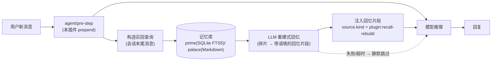

# dsh-recall-rebuild

[](https://www.npmjs.com/package/dsh-recall-rebuild)
[](https://github.com/linkpain/dsh-recall-rebuild/blob/main/LICENSE)
[](https://github.com/linkpain/dsh-recall-rebuild/stargazers)
[](https://github.com/deepseek-ai/DeepSeek-Harness)
[](https://nodejs.org)

> **重建式回忆增强插件(DeepSeek Harness)**:增强现有记忆插件,让"回忆"从"念档案"变成"想起来了"。
> **Enhancer for DSH memory plugins**: recall that feels like *remembering*, not *quoting a file*.

`dsh-prime-memory` 等现有 DSH 记忆插件已经把**存储层**做得非常扎实——跨会话捕获、蒸馏、持久化都很成熟,值得先装它们。本插件**不做重复的事**,只在一个环节上做增强:**回忆的呈现方式**——把检索到的记忆碎片交给 LLM 重建为带语境与情绪的回忆片段再注入,让"想起来了"更自然,而不是"念档案"。

---

## 痛点:回忆不应该是"念档案"

**传统记忆插件(录音式)**:检索 → 把原文/摘要塞进上下文。

> 用户:我今天心情不太好。
> 助手(传统):根据我的记录,你喜欢喝冰美式咖啡、养了一只叫煤球的猫、上周去过成都出差。你怎么了?

**本插件(重建式回忆)**:检索 → LLM 按当前对话现场重建 → 注入一段"回忆"。

> 用户:我今天心情不太好。
> 助手(本插件):记得你养了只叫煤球的黑猫,平时它一蹭你你就笑;上周你还说靠冰美式续命。今天是不顺心了吗?

同一份记忆,前者是"读档案",后者是"想起来了"。**对桌宠、虚拟角色、陪伴型助手来说,这决定了它像机器还是像活人。**

## 特性

- **只读增强,零污染**:以 `readOnly` 打开现有记忆库(`$DSH_HOME/memory/memory.db`),不重写捕获管线、不写任何数据,装/卸都不影响原插件;
- **多记忆源可插拔**:`source` 支持 dsh-prime-memory(SQLite FTS5)与 dsh-memory-palace(Markdown 文件)两种底层记忆,`auto` 自动探测,后续可继续扩展;
- **生成式重建**:在 `agent/pre-step` 用会话末尾消息召回碎片,LLM 重建为带语境/情绪/时间感的回忆片段,替代生硬原文注入;
- **与生态共存不错位**:注入消息 `source.kind='plugin:recall-rebuild'`,不会被 prime-memory 当作新用户消息再次捕获/蒸馏;`replace` 策略原位替换对方的原文召回,`append` 策略追加,不重复注入;
- **永不阻塞对话**:无记忆库/无模型路由/超时/重建失败,一律静默跳过本轮;
- **零部署硬件成本**:不买显卡、不租 GPU,重建调用走宿主已有的 LLM 路由,每轮只消耗百级 token;
- **零额外运行时依赖**:用 Node 22+ 内置 `node:sqlite` 读库,安装即用。

## 适合谁

- DSH **桌宠 / 虚拟角色 / 陪伴型 AI** 玩家——想要"像人一样记着你",而不是"查到你的档案";
- 已把角色接入 **QQ / 微信** 等 IM 的 DSH 用户——记忆需要跨会话"想得起来";
- 觉得现有记忆插件"注入的原文太生硬、像在念记录"的开发者与用户。

## 安装

前置:

- DeepSeek Harness `0.1.0-rc.2 … 0.2.1-rc.3`;
- Node ≥ 22.5(需要内置 `node:sqlite`);
- 已安装并运行过 `dsh-prime-memory`(0.26.x,SQLite 记忆库)**或** `dsh-memory-palace`(Markdown 记忆文件),且已有记忆数据。

```bash
dsh plugin --profile <你的配置文件名> add dsh-recall-rebuild
```

安装后无需手动改 profile 的 `cordis.patch.yml`(包内组合层自动插入插件行)。
如需覆盖配置,在 profile 的 `cordis.patch.yml` 写**顶层裸 patch**(同 id 再 insert 会报 duplicate loader entry,按行整体替换、不深合并):

```yaml
- id: recall-rebuild
  name: dsh-recall-rebuild
  config:
    enabled: true
    rebuild:
      maxResults: 5
      maxOutputChars: 600
      timeoutMs: 8000
    inject:
      strategy: replace   # replace = 替换 prime-memory 的原文注入; append = 追加
```

## 工作原理



一句话流程:**检索 → 重建 → 注入**,而不是**检索 → 注入**。

## 与现有插件的错开与共存

- 注入消息 `source.kind` 用 v4 语义 `plugin:recall-rebuild`,与 prime-memory 的 `plugin:memory` 互不干扰;capture 侧只收 `source.kind==='user'`,天然不被二次捕获。
- `strategy=replace` 时只替换本轮**已存在的**原文召回消息;没有则退化为追加,不重复注入。

## 配置项

| 键 | 默认 | 说明 |
| --- | --- | --- |
| `enabled` | `true` | 总开关 |
| `dataDir` | `''` | 记忆库目录;空 = `$DSH_HOME/memory` |
| `source` | `auto` | 记忆来源:`auto` 自动探测(prime → palace);`prime` = dsh-prime-memory SQLite 库;`palace` = dsh-memory-palace Markdown 文件 |
| `rebuild.enabled` | `true` | 重建式回忆开关;`false` 退化为原文检索注入 |
| `rebuild.maxResults` | `5` | 每轮检索条数 |
| `rebuild.maxMemoryChars` | `400` | 单条记忆进重建 prompt 的字符上限 |
| `rebuild.maxTotalChars` | `2000` | 重建 prompt 记忆总量上限 |
| `rebuild.maxOutputChars` | `600` | 重建片段输出上限 |
| `rebuild.temperature` | `0.7` | 重建调用温度 |
| `rebuild.maxTokens` | `1024` | 重建调用输出 token 上限 |
| `rebuild.timeoutMs` | `8000` | 重建总超时;超时跳过本轮 |
| `inject.strategy` | `replace` | `replace` = 原位替换 prime-memory 的原文召回;`append` = 追加 |
| `inject.maxChars` | `1200` | 注入正文单条上限 |
| `inject.includeSources` | `true` | 注入时附记忆来源 id 标注 |
| `query.tailMessages` | `8` | 召回查询取会话末尾消息条数 |
| `query.maxChars` | `1200` | 召回查询字符上限 |

## Roadmap

- [ ] 更多记忆源 adapter(`@max-null/dsh-memory`、`dsh-memory-gate` 等 SQLite/文件变体);
- [ ] IM 用户级命名空间隔离(跨 QQ/微信的同一人记忆共享);
- [ ] 重建质量可观测:注入效果对比开关 + 每轮重建日志;
- [ ] 睡眠巩固 / 联想扩散(更接近人脑的长期记忆子系统的后续阶段)。

## 局限(如实声明)

1. **只增强召回/呈现层**:底层库捕获了什么,重建就基于什么;库缺字段(如没有情绪标注)时,重建不会凭空造出它。
2. **幻觉受控但非零**:重建 prompt 明确禁止编造碎片外事实,但 LLM 仍有漂移概率;注入标注记忆依据 id 便于审计。需要强事实的场景可关掉重建(`rebuild.enabled=false`)。
3. **token 消耗**:每轮召回命中即产生一次重建调用(通常百级 token),由宿主模型路由计费。
4. **未覆盖**:LoRA 权重内化等权重级记忆不在本插件范围(见 Roadmap)。

## 开发与验证

```bash
npm install
npm run typecheck   # tsc --noEmit
npm run build       # 编译到 dist/
node scripts/verify.mjs   # 运行时验证:导出/Config/prime FTS+LIKE/palace Markdown/降级
npm pack --dry-run  # 检查发布包内容
```

## License

MIT

---

## English Overview

**dsh-recall-rebuild** is an *enhancer* for memory plugins in [DeepSeek Harness](https://github.com/deepseek-ai/DeepSeek-Harness) (DSH). Existing memory plugins such as `dsh-prime-memory` (SQLite) or `dsh-memory-palace` (Markdown) already handle *storage* very well — cross-session capture, distillation and persistence are mature, so install one first. This plugin does **not** duplicate that work; it enhances a single layer: **how memories are recalled** — instead of injecting raw snippets as-is, it has the LLM reconstruct them into contextual recollections, so "remembering" feels natural rather than like quoting a file.

This plugin upgrades the **recall/presentation layer**:

- Opens the existing memory store (`$DSH_HOME/memory/memory.db`) **read-only**, never writes, never touches the capture pipeline;
- Before every model step, it retrieves memory fragments and asks the LLM to **reconstruct** them into contextual, emotionally-toned recollection snippets (using only in-fragment facts — no fabrication);
- Injects via `agent/pre-step` with `source.kind='plugin:recall-rebuild'`, so it is never re-captured by the underlying memory plugin; `replace` strategy swaps out the other plugin's raw-text recall in place, `append` adds alongside;
- **Never blocks a conversation**: missing store, missing model route, timeout or rebuild failure all silently skip the step;
- **Zero infra cost**: no GPU/VM — rebuild calls go through the host's existing LLM routing, ~hundreds of tokens per hit; uses only Node's built-in `node:sqlite`.

**Who it's for**: DSH desktop-pet / virtual-character / companion users who want the bot to "remember like a person" rather than "quote a file", including characters bridged to QQ/WeChat.

Install (after `dsh-prime-memory`):

```bash
dsh plugin --profile <your-profile> add dsh-recall-rebuild
```
